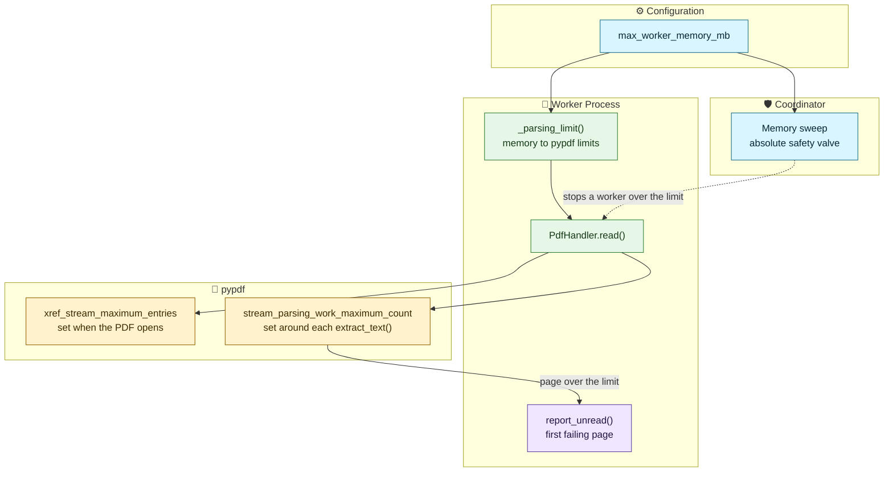

# PIIDigger - PDF Memory Limits Architecture

## Overview

### Purpose
This document explains how the PDF handler sets pypdf's parsing limits. It also records the measurements behind those limits.

### Context
The rule runs inside each worker process, in `PdfHandler.read()`. It works with the worker memory limit that the coordinator's memory sweep enforces.

### Status
Active in 2.0.

### Scope
This document covers pypdf's parsing limits and garbage collection after each PDF. The [Coordinator/Worker Task Pipeline](../orchestration/coordinator-worker-pipeline.md) covers the memory sweep and worker retirement. The font cache has its own notes in `filehandlers/pdf.py`.

## Architectural Principles

### Design Goals
- **Read every legitimate page**: pypdf's default limits reject real documents, so PIIDigger sets its own.
- **Lose a page, not a file**: A limit skips one page and keeps the rest. A memory kill loses everything read in that task.
- **One setting to raise**: `max_worker_memory_mb` controls both limits, so a user changes one value.

### Key Benefits
- **No invented number**: The limit comes from the worker's memory, the real safety valve.
- **No cost to normal pages**: Only a page that large uses that memory.
- **A clear report**: The unread message names the first failing page and its exception.

## Architecture Diagram



## Core Implementation

The limit assumes 512 MB for everything other than one content stream, and sizes the stream's limit from the rest of `max_worker_memory_mb`. Nothing in PyPDF or PIIDigger actually partitions the memory. The 512 MB is an assumption in this arithmetic, not an allocation. A document that needs more leaves less for its pages, and the only enforced bound is the worker memory limit (`max_worker_memory_mb`).

```python
def _parsing_limit(max_worker_memory_mb: int, mb_per_million: int) -> int:
    allowance_mb = max_worker_memory_mb - _RESERVED_MEMORY_MB
    return max(_MIN_PARSING_LIMIT, allowance_mb * 1_000_000 // mb_per_million)
```

The handler calls it twice, once for each pypdf limit, with a different cost per million:

| Limit | What it counts | Cost per million | What reaching it costs |
|---|---|---|---|
| `stream_parsing_work_maximum_count` | Parsing work in one content stream | 133 MB | One page, which is skipped and reported |
| `xref_stream_maximum_entries` | Cross-reference entries in the file | 85 MB | The whole document, reported as `PdfReadError` |

| `max_worker_memory_mb` | Allowance | Token limit | xref limit |
|---|---|---|---|
| 512 or less | Minimal | 2,000,000 (the floor) | 2,000,000 (the floor) |
| 1,024 (default) | 512 MB | About 3,850,000 | About 6,020,000 |
| 2,048 | 1,536 MB | About 11,550,000 | About 18,070,000 |
| 4,096 | 3,584 MB | About 26,950,000 | About 42,160,000 |

The token limit is a ContextVar setting. The handler applies it around each `extract_text()` call and never holds it across a `yield`.

pypdf swallows the xref limit error and logs it below PIIDigger's log level. The handler sees only the later failure, so its message cannot name this cause.

### Why a fixed reserve

The memory for "everything else" depends on the PDF, not on the worker setting. A larger worker gives all its extra memory to the page.

| PDF file size | Pages | After opening | Peak, including its largest page |
|---|---|---|---|
| Nothing open, handlers imported | | 58 MB | 58 MB |
| 1–7 MB | 31–450 | 60–66 MB | 75–82 MB |
| 21 MB | 471 | 84 MB | 120 MB |
| 40 MB | 592 | 102 MB | 279 MB |
| 109 MB | 471 | 320 MB | 604 MB |
| 125 MB | 2,870 | 206 MB | 409 MB |
| 157 MB | 781 | 225 MB | 396 MB |

The 512 MB reserve covers all but the largest of these peaks. A very large PDF with a maximum-size page can still reach the worker limit. The scan reports that file as over the memory limit.

### Why the conversion uses 133 MB

A token's cost depends on the operator, so no single figure fits every page. Synthetic single-stream pages measured:

| Page content | MB per million tokens |
|---|---|
| `cm` | 80–85 |
| `q Q` | 127 |
| `(a) Tj` | 133 |
| `q` | 243 |

133 MB balances two needs at the default worker limit:

- **Real pages still read**: Real pages over pypdf's default needed at most 3,000,000 tokens, within the limit of about 3,850,000. Each read in 5.3–6.1 s and peaked 60–110 MB above its failed attempt at 2,000,000.
- **The costliest stream stays near the worker limit**: A stream of `q` tokens at the limit reached 1,021–1,025 MB in testing, against the 1,024 MB limit. It can go either way.

The worst-case figure of 243 MB would set the limit near 2,100,000, and real pages would fail again.

### Why the xref limit uses 85 MB

Reaching the xref limit costs the whole document, so it gets more room than tokens. Entries were measured at about 55 MB per million, so 85 MB stays on the cautious side. One real file has 3,524,690 entries and fits within the limit of about 6,020,000. It opened in 6.5 s. That is one real file, not a hostile one.

### Known limits

The limits lower the risk of a memory kill or a timeout, but do not remove it. In these cases the scan reports the file, and it loses that file's findings.

- **Nested forms**: The token limit is per stream, not per page. Each nested form gets the full limit while its parents stay in memory. A page with two nested forms of 4,000,000 tokens each peaked at 1,157 MB, before the limit moved to 3,850,000.  At that memory usage and default settings, the worker is terminated as over-`max_worker_memory_mb`.
- **Dense text and the deadline**: Parse time also depends on the operator. `cm` tokens took about 2.4 s per million, and `(a) Tj` tokens about 21 s per million. A page of 3,500,000 `(a) Tj` tokens took about 73 s, past the default 60 s deadline. Progress reports only arrive between pages.
- **Larger workers**: The margin shrinks as `max_worker_memory_mb` rises, because the limit assumes 133 MB per million and `q` tokens cost 243 MB. At 2,048 MB, the limit is about 11,550,000 tokens, which works out to about 2.8 GB of `q` tokens. That figure is arithmetic, not a measurement.
- **Large documents**: A very large PDF with a page near the limit can still reach the worker limit.
- **Fixed pypdf limits**: Other limits, such as a 75 MB decompression limit per stream, do not follow `max_worker_memory_mb`. They can cap a page before the token limit does, especially on a large worker.

### Why there is no retry

We considered using a dynamic token/xref limit that we could raise if we hit it.  But, in testing we noted that parsing at a low limit and retrying a failed page at a higher one offers no benefit:

- **The retry reaches the same peak**: It also spends about 4.5 s on the failed attempt first.
- **A memory kill costs more**: Findings arrive when a task finishes, so a kill loses the whole task. For an archive, that task is a batch of members.
- **xref cannot retry**: pypdf hides that error, so nothing reliable triggers a retry.  Plus, this is a per-document (not per-page) limit.

A retry becomes safe only if findings stream from a task as it runs, which is not currently under consideration.

### Garbage collection

The handler calls `gc.collect()` once when each PDF finishes. It drops its own references to the document first, because a collection cannot free what the frame still holds.


## Testing Notes

- `tests/test_read_pdf_file.py` holds a slow test with a real 2,500,000-token page, read at the default limit and reported at a low one.
- A test fails if a pypdf bump removes either the token or xref setting. Without it, a removed setting would raise `TypeError` and read as every page being unreadable.
- No test covers the xref limit with a real file, because the only known example is not in the repository.

## Cross-References

- [Coordinator/Worker Task Pipeline](../orchestration/coordinator-worker-pipeline.md)
- [Troubleshooting User Guide](../../user-guides/troubleshooting.md)
- [filehandlers/pdf.py](../../../src/piidigger/filehandlers/pdf.py)
